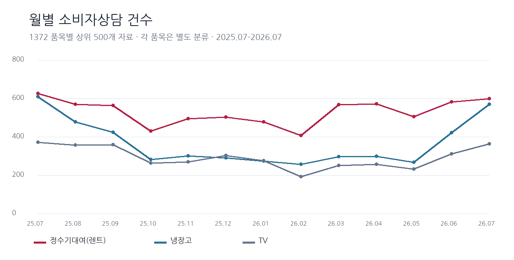
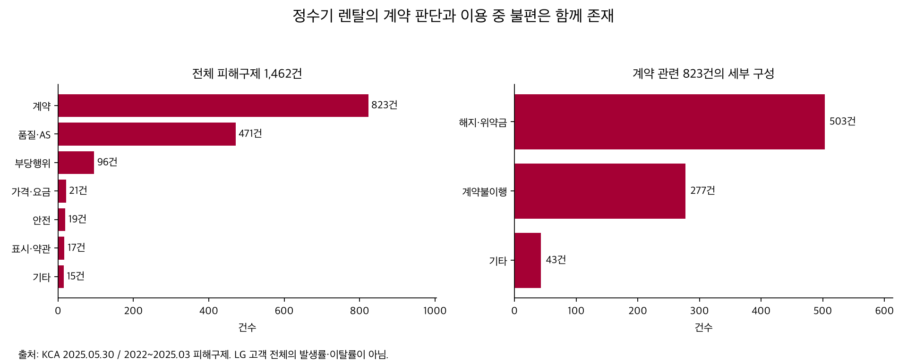
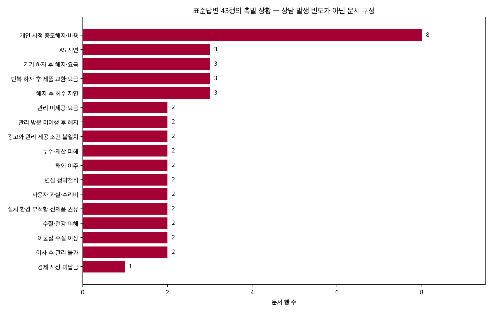

# 정수기 계약 이해·유지·재구독 판단 지원 — 인사이트 리포트

## 1. 분석 목적

품목별 상담 규모를 비교해 분석 대상을 선정하고, 정수기 고객이 어떤 상황에서 계약과 비용을 확인해야 하는지 살펴본다. 이를 통해 유지·교체·해지를 판단하는 데 필요한 계약 정보와 Agent의 지원 범위를 정한다.

## 2. 데이터 설명

| 자료 | 범위·건수 | 용도·한계 |
|---|---|---|
| 품목별 상담 현황 — 기존 분석 | 2025.07~2026.07, 13개 파일 6,500행, 정수기대여 누적 6,902건 | 주제 규모. 모두 계약 문의라는 뜻이 아니며 고유 고객 수 아님 |
| 정수기대여 표준답변 | 전체 1,332행 중 43행, 공백 제거 고유 질문 31개 | 촉발 상황·요구 결과·필요 정보 재분류. 문서 구성이지 상담 빈도 아님 |
| KCA 2025 피해예방 PDF | 2022~2025.03 피해구제 1,462건, 연령 확인 1,441건 | 최신 확보 정수기 피해 근거. LG 고객만의 자료 아님 |
| KCA 2019 공식 안내 | 2018.01~2019.06, 951건 중 채권추심 177건 제외한 774건 | 관리 불만과 중도해지 비용 문제의 연결. 과거 보조 근거; 현재 발생률로 사용 안 함 |
| LG 구독·FAQ·교체보상 안내 | 2026-10-08 확인 원문 3개 | 유지 대안·교체 선택지 설명 자료. 고객 수요·효과 통계 아님 |

원문 및 수집 상태: [추가 자료 출처 목록](../자료/원본/유지전환_보완/출처목록.csv). LG 원문 3개는 다운로드했다. KCA 추가 원문 2개는 인증서 오류로 직접 수집하지 못했으며 웹 도구 확인 기록과 실패 상태를 보존했다. 기존 KCA 2025 PDF는 로컬 원본으로 재확인했다.

### 자료별 출처와 주요 컬럼

| 자료 | 제공처·원문 | 주요 컬럼·추출 항목 |
|---|---|---|
| 월별 품목별 상담 현황 | 한국소비자원·공공데이터포털, [품목별 상담 현황](https://www.data.go.kr/data/15120072/fileData.do) | 연도, 월, 품목명, 상담건수, 전월대비 증감률, 전년동월대비 증감률 |
| 소비자상담 표준답변 | 한국소비자원, 2025-07-25 기준 배포 파일 | 번호, 품목명, 구분, 질문, 답변 |
| 정수기 렌탈 피해예방 안내 | 한국소비자원, 2025-05-30 발표 원문 PDF | 피해구제 사유·건수·비율, 계약 세부 유형, 연령별 건수, 사례·주의사항 |
| LG 구독·FAQ·교체보상 | LG전자 공식 안내, 2026-10-08 확인 | 적용 대상·모델, 기간, 혜택 형태, 관리·계약 확인 항목 |

분석 대상 기간과 수집·확인일은 구분한다. 월별 파일의 대상 기간은 2025-07~2026-07, 표준답변은 2025-07-25 기준이다. 이 두 원본의 실제 다운로드일은 별도 기록되지 않아 특정 날짜로 제시하지 않는다. 보완 자료의 확인일·수집 성공 여부는 출처 목록에 기록했다.

## 3. 데이터 전처리

- 월별 13개 파일의 UTF-8-SIG·CP949 인코딩을 확인하고 열명·문자열 앞뒤 공백을 정리했다. 6,500행에서 핵심 열 결측·빈 문자열 0건, 연월×품목 중복 0건을 확인했다.
- 상담건수는 수치형으로 변환해 음수·소수 건수가 없음을 검증했다. 연월을 정렬하고 13개월의 연속성을 확인했다. 월별 큰 변화는 임의 삭제하지 않고 추이에 남겼다. 증감률은 제공값과 건수 재계산을 구분했다.
- 표준답변 CP949를 읽고 모든 열의 앞뒤 공백을 정리했다. 분석 대상 질문·답변·번호·구분에 빈값이 없어 대체하지 않았다.
- 질문의 모든 공백을 제거한 키로 31개 고유 질문을 확인했다. 법적 조건이 다른 유사 질문을 같은 질문으로 강제 합치지 않았다.
- 원본 구분을 보존하고 43개 번호 전체에 촉발 상황·해지 표현·타인 신제품 권유·완료된 제품교환 등을 수작업 코딩했다. 분류 기준과 전체 행은 CSV 및 노트북에 남겼다.
- 계약 관련 823건의 세부 합계 503+277+43, 전체 피해 1,462건의 사유 합계, 연령 확인 1,441건 합계를 검산했다.
- 품질·AS 471건의 원문 비율은 32.1%지만 471÷1,462 재계산은 32.2%다. 원문과 재계산을 별도 열로 보존했다.
- 2019·2025 통계, 표준 문서, 행사 안내를 합산하거나 서로 같은 모집단의 증가율로 계산하지 않았다.

실행 결과를 포함한 [분석 노트북](../노트북/불편_유지전환_보완분석.ipynb)과 [43행 내용 분류](../가공결과/유지전환/표준답변_43행_내용분류.csv)를 참조한다.

## 4. 주요 분석 결과

### 4.0 정수기대여를 분석 대상으로 선정한 이유

같은 13개월 동안 정수기대여 상담은 6,902건, 냉장고 4,775건, TV 3,811건이다. 비교한 세 품목에서는 정수기대여가 매월 가장 많았다. 전체 가전 중 최다라는 뜻은 아니며, 제품 보급 대수나 이용자 수로 나눈 발생률도 아니다.

정수기대여는 2025-07의 626건에서 2026-02의 408건까지 줄었다가 2026-07에는 600건이었다. 2026-07은 전월 582건보다 3.1% 많고, 전년 동월 626건보다 4.2% 적다. 따라서 지속 증가로 해석하지 않고 상담 규모와 기간별 변화를 근거로 품목을 선정했다.

### 4.1 계약 판단과 사용 불편을 별개로만 볼 수 없다

KCA 피해구제 1,462건 중 계약 823건, 품질·AS 471건이다. 계약 823건 안에서는 해지·위약금 503건, 계약불이행 277건, 기타 43건이다. 계약불이행 277건 모두가 관리 미이행이라는 뜻은 아니다.

[2025 KCA 원문](https://www.kca.go.kr/home/sub.do?menukey=4005&mode=view&no=1003878293) 5쪽은 약정 관리가 반복 이행되지 않아 해지를 요구한 사례를 다룬다. 6쪽은 제품을 교체할 때 기존 계약 유지·변경과 신규 계약 체결 여부를 확인하도록 권고한다. 따라서 ‘이용 중 불편 → 다음 선택 → 계약 조건 확인’은 공개 자료와 연결된다. 고객 유지율 향상까지 입증하는 것은 아니다.

### 4.2 질문에서도 불편과 해지 판단이 함께 나타난다

- 43행 중 해지 표현이 있는 문서 31행, 고유 질문 기준 21개.
- 관리·AS·품질 촉발과 해지 표현이 함께 있는 문서 13행, 고유 질문 기준 9개.
- 신제품 권유가 나오는 문서 2행은 고객의 자발적 혜택 목적 교체 의사가 아니라 설치 환경 문제와 사업자의 권유다.
- 제품 교환이 완료된 문서 3행은 수리·교환 과정의 요금 문제이며 새 구독 가입과 다르다.
- 해당 문서에서 고객이 더 좋은 혜택을 얻으려고 새로 구독하려는 의사는 직접 확인되지 않았다. 시장에 그러한 수요가 없다는 결론은 아니다.

| 표준답변 번호 | 촉발 상황 | 필요한 판단 | Agent 지원 |
|---|---|---|---|
| 977·988 | 관리 방문 미이행 뒤 해지 고민 | 약정·이행 이력·책임 확인 | 필요한 기록 정리·공식 상담 준비. 자동 위약금 면제 판정 금지 |
| 978·989·1004 | AS 지연으로 이용 어려움 | 해지·보상·청구 조건 | 서로 다른 요구 결과를 확인하고 상담 자료 정리 |
| 986·995·1007 | 반복 하자 후 제품 교환 | 교환과 신규 계약의 차이, 미사용 기간 요금 | 신규 구독 권유로 대체하지 않고 조건 확인 |
| 981·992 | 이사 장소 부적합·신제품 권유 | 기존 계약 유지·종료, 설치 가능 여부 | 제품 기능·환경과 계약 변동 확인 |
| 971~974 | 개인 사정 중도해지 | 기간·정산 조건 | 지원하는 계약의 검토일별 계산·미확인 항목 안내 |

### 4.3 연령 근거는 보완되지만 대표성을 과장하지 않는다

KCA 2025 원문 3쪽의 연령 확인 1,441건 중 40대 500건(34.7%), 50대 339건(23.5%), 30대 302건(21.0%)이다. 30~50대 합계는 79.2%지만 피해구제 신청자 부분집합이며 전체 LG 고객 구성이나 35세 맞벌이의 불편을 입증하지 않는다. 대표 이서연은 가상 상황 설명용으로 유지하고 상황 중심으로 정의한다.

### 4.4 전환 혜택은 실제 대안이지만 즉시 비용 차감이 아니다

[LG 교체보상 공식 안내](https://www.lge.co.kr/benefits/exhibitions/detail-PE01006002)에서 2026년 10월 신청 기간과 대상 모델·수거·설치 기한·제외 고객·멤버십 적립 조건을 확인했다. 이를 RAG에 추가했다. 개인 적용 자격·잔여 인원·변경 여부는 확인되지 않았고, 첫구독 혜택을 기존 고객에게 자동 적용하지 않는다. 포인트를 해지 비용이나 월요금의 즉시 현금 할인으로 차감하지 않는다.

## 5. 최종 인사이트 선정 내용

**핵심 서비스: 개인 계약의 기간·정산과 새 구독 조건을 이해하고 유지·재구독·해지의 다음 행동을 판단하는 정수기 계약 상담 Agent.**

**CX 문제:** 정수기 구독 고객은 유지·교체·해지를 고민하는 상황에서, 자신의 계약기간·종료 비용과 새 구독 조건을 함께 확인하기 어려워 다음 행동을 판단하는 데 불편을 겪는다.

- 확인한 사실: 계약·해지/위약금 피해의 규모, 불편에서 계약 판단으로 이어지는 공개 질문·사례, 제품 교체 시 기존/신규 계약 조건 확인 필요.
- 선정 해석: 개인 계약 조회와 기존 종료 비용을 포함한 새 구독 비교·상담 준비에 집중한다.
- 사용방법·오류 해결은 LG 공식 AI Chat으로 연결. 제품의 핵심 기능·요금·관리는 새 모델 계약 비교 자료로 유지한다.
- 한계: 피해구제 사례로 자발적 재구독 수요·LG 고객 전체의 불편·유지율 개선을 입증하지 않는다.
- 검증 가설: 계약기간 이해, 비용 누락 감소, 다음 상담 준비 개선. 실제 사용자 비교 과제로 확인한다.

공개 근거 검색 → 필요한 개인 계약 동의·조회 → 고객이 고른 모델과 날짜의 부담 계산 → 확인된/미확인 항목 구분 → 고객용 준비서가 핵심 흐름이다. 책임·면제·미래 가격·실제 처리는 확정하지 않는다.
